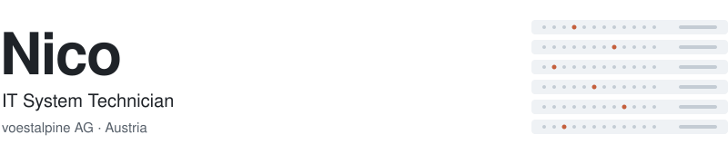

<picture>
  <source media="(prefers-color-scheme: dark)" srcset="assets/header-dark.svg">
  <source media="(prefers-color-scheme: light)" srcset="assets/header-light.svg">
  
</picture>

I keep enterprise infrastructure running at scale and build small tools that take repetitive work off the table.

## Focus

| Area | What I work on |
| :--- | :--- |
| **Enterprise IT operations** | Day-to-day operation of company-wide systems for 6,000+ users |
| **Infrastructure** | Virtualization and network infrastructure |
| **Software development** | Desktop utilities, web tooling and automation, with Claude in the workflow |

## Stack

| Category | Technologies |
| :--- | :--- |
| **Languages** |      |
| **Frameworks** |  |
| **Tooling** |    |

## Contributions

<picture>
  <source media="(prefers-color-scheme: dark)" srcset="assets/contributions-dark.svg">
  <source media="(prefers-color-scheme: light)" srcset="assets/contributions-light.svg">
  
</picture>
